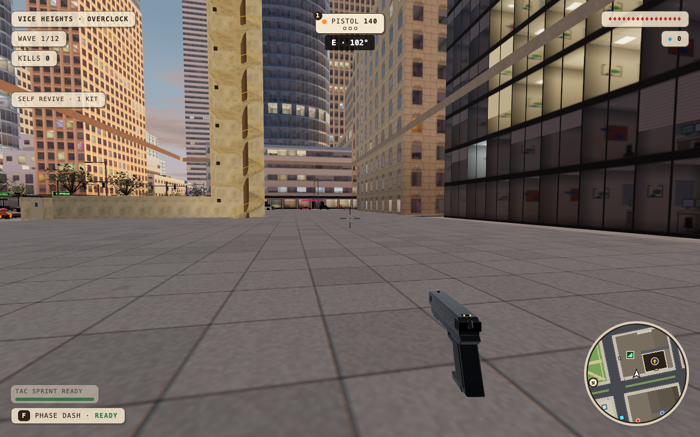
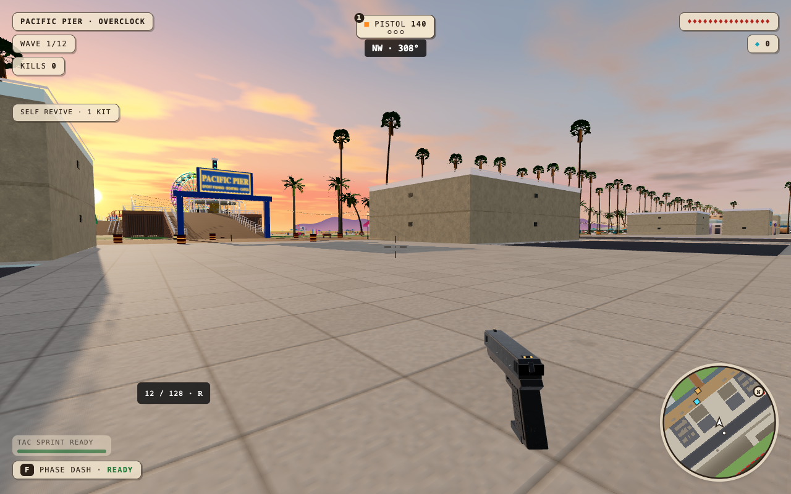

<div align="center">

# Scrapfall

A wave-survival shooter played in the browser, fought across real-scale maps. Solo or co-op with up to four players. No install, no account.

<a href="https://github.com/tszaks/scrapfall/actions/workflows/ci.yml"></a>


### [Play at szakacsmedia.com/game](https://szakacsmedia.com/game/)



</div>

---

Scrapfall is a standalone game by **Tyler and Toby Szakacs** ([Szakacs Media](https://szakacsmedia.com)). You fight twelve waves of scrap-built robots across four large real-scale maps. Each map has its own boss, hazard, traffic and events.

It is made for anyone with a browser and a few minutes: play alone, or send a room code to up to three friends. The source is public so you can read it and learn from it. It is not open for reuse: see [License](#license).

## Maps

| Map | Setting | Boss |
| --- | --- | --- |
| **Vice Heights** | A big-city downtown with 480 m towers, a park, a boardwalk, traffic, police chases, elevators and rooftops | The Kingpin |
| **Dry Gulch** | A railroad boomtown with a walk-in saloon, jail, bank and livery, a stagecoach, a sheriff's posse and a freight train | The Iron Marshal |
| **Pacific Pier** | A beach town with a rideable Ferris wheel, a coaster, a skate park and a coast road | The Kraken Rig |
| **Whiteout Pass** | An alpine ski village with a rideable chairlift, a summit lodge and a clock-tower belfry | The Avalanche Engine |

The four big maps are built at real scale (1 unit = 1 metre, about 800 × 800 m). Solo play
seals off a smaller 560 m area with in-world blockades; co-op opens the whole map.

<p align="center">
  
</p>

## Features

- **Twelve waves and a boss per map.** About 17 enemy types, each warning you before it
  attacks: snipers with laser sights, grenadiers, shield bulwarks, flankers, cloakers,
  hornet swarms and more.
- **Five classes, eight abilities and 16+ guns.** Each gun has its own projectile. The
  Boomer and Flak deal real splash damage, metal rounds drop under gravity, and the
  Longshot sniper has a 4× scope.
- **Five difficulty levels:** Rust Bucket, Salvage, **Overclock** (the default), Meltdown
  and Scrapfall.
- **Every match rolls its conditions:** sunny, rain, night or sunset, kept for the whole
  run. Each big map also has an event (a blackout, a train robbery, a wave surge or an
  avalanche) and a boss-round hazard.
- **Things you can climb and go into:** elevators on towers of five floors or more,
  stairwells and spiral stairs, ladders, rooftops you can jump off (fall damage scales
  with height), and walk-in interiors.
- **Co-op** for up to four players, peer to peer. Enemies, traffic, lifts and events stay
  in sync. Ping enemies, revive teammates, and join a match already in progress.
- **Plays on anything with a browser:** keyboard and mouse, controllers (Xbox,
  PlayStation, Switch Pro) with remappable buttons, or touch controls on phones. First or
  third person.

## Controls

The defaults are below. Everything can be remapped in **Settings**, where you can also
choose Auto, Keyboard + Mouse or Controller.

| Action | Keyboard + mouse | Controller |
| --- | --- | --- |
| Move / look | W A S D / mouse | Left stick / right stick |
| Shoot | Hold left click | RT / R2 / ZR |
| Aim down sights | Right click | LT / L2 / ZL |
| Jump | Space | A / ✕ / B |
| Sprint | Hold Shift | Click left stick |
| Tactical sprint | Double-tap Shift | Double-click left stick |
| Ability | F | B / ○ / A |
| Switch weapon | 1-0, Q / E | LB / RB, d-pad |
| Elevator floor button | E (in the car) | X / □ / Y |
| Ping | G / middle click | Y / △ / X |
| Revive | Hold R | Hold right stick in |
| Shop | Z X C · H · R | LB / RB, then X / □ / Y |
| First / third person | V | Assign in Settings |
| Big map | M | View / Create / − |
| Pause | P / Esc | Menu / Options / + |

On-screen hints switch to your controller's own button symbols automatically. On phones,
JUMP and SPRINT buttons appear; tap SPRINT twice for a tactical sprint.

<details>
<summary><b>More rules</b> (revives, falls, the sniper)</summary>

- **Solo revives:** you start each run with one self-revive kit. While you're down, hold
  Revive for 3 s before the 20 s bleed-out ends. A revive restores half your health and
  gives you 3 s of protection. Replacement kits cost 12 shards in the shop.
- **Falls:** jumps clear waist-high props, but taller barriers still block you. A fall of
  seven or more floors downs you.
- **Downed players** draw no new attacks; enemies go after a standing teammate instead.
- **The Longshot** unlocks at wave 4, carries 12 rounds and is zeroed at 50 m.

</details>

## Quick start

To play, open [szakacsmedia.com/game](https://szakacsmedia.com/game/). To run it locally:

You need Node.js 20.19 or newer.

```sh
npm ci
npm run dev            # open the printed URL + /game/
npm test               # physics, ballistics and match-weather regressions
```

Useful URL options: `?map=vice|gulch|pacific|whiteout`,
`?weather=sunny|rain|night|sunset`, `?shadows=0|1`, and `?debug=1` for developer handles.

## Build and deploy

The game is a static single-page app served under `/game/`. There's no server.

```sh
npm run build          # outputs dist/site/game/
npm run serve:static   # serves it like production: http://localhost:4173/game/
```

Production runs on Vercel (`vercel.json`), and a merge to `main` deploys it.
szakacsmedia.com proxies `/game/*` to the deployment. `main` is protected, so changes go
in through pull requests.

## Code map

The full map, with every folder, is in [docs/REPO_MAP.md](docs/REPO_MAP.md). If you're an agent or contributor, read [AGENTS.md](AGENTS.md) first.

| Path | What's there |
| --- | --- |
| `src/game/Game.tsx` | The game loop, weapons, enemies, waves, HUD and co-op |
| `src/game/cityLayout.ts`, `City.tsx`, `cityMesh.ts` | Vice Heights: the generator and the renderer |
| `src/game/western/`, `beach/`, `alpine/` | The other maps |
| `src/game/nuketown/` | Nuketown (work in progress; hidden in production, reachable only in the dev server with `?map=nuketown`) |
| `src/game/access/` | Elevators, stairs, ladders and rooftops, shared by every map |
| `src/game/trafficSim.ts`, `Traffic.tsx`, `pursuit.ts` | Traffic and police chases |
| `src/game/terrain.ts`, `soloBounds.ts`, `posts.ts` | Ground height, solo blockades, thin-prop collision |
| `src/game/input/` | Controllers, remapping, sprint and jump, falls, aiming |
| `src/game/art/` | Guns, robots and vehicles |
| `src/game/ambience.ts`, `audio.ts` | Procedural sound and music |
| `src/game/net.ts` | Co-op over PeerJS |

## FAQ

**Does it phone home?**
There is no analytics, no ads and no account. The game makes two kinds of network requests, both for co-op only. To find other players it uses the public PeerJS signalling service and a public Google STUN server, then connects browser to browser. To relay traffic when a direct link is blocked, it asks `/game/api/turn` (`api/turn.ts`) for short-lived Cloudflare TURN credentials. If that endpoint is missing or slow, co-op falls back to STUN only. Solo play makes no game requests beyond loading the page and its assets.

**Why does co-op sometimes fail to connect?**
Some networks (phone hotspots, strict firewalls) block direct links. The TURN relay covers most of these cases. Host and guest must both load the same build, because the room name carries a version prefix.

**Can I reuse the code or art?**
Please ask first. See [CONTRIBUTING.md](CONTRIBUTING.md) and [LICENSE](LICENSE).

## Contributing

The source is public to read. The license reserves all rights, so outside code contributions are not accepted by default. Bug reports and ideas are welcome: read [CONTRIBUTING.md](CONTRIBUTING.md) first. Security problems go through [SECURITY.md](SECURITY.md). Everyone taking part follows the [Code of Conduct](CODE_OF_CONDUCT.md). Agents and maintainers: start with [AGENTS.md](AGENTS.md).

Docs: [repo map](docs/REPO_MAP.md) · [performance](docs/performance.md) · [controller diagnostics](docs/controller-diagnostics.md) · [upstream sync](docs/UPSTREAM.md) · [changelog](CHANGELOG.md)

## Credits

Made by **Tyler Szakacs** and **Toby Szakacs** at [Szakacs Media](https://szakacsmedia.com).

- **Toby:** Scrapfall's core game, including the classes, loadouts, abilities, shop,
  guns and touch controls.
- **Tyler:** the real-scale maps (Vice Heights, Dry Gulch, Pacific Pier, Whiteout Pass,
  Nuketown) and the systems around them.

## License

All rights reserved. The source is public to read and learn from: see [LICENSE](LICENSE). Please ask before reusing the code or assets.
